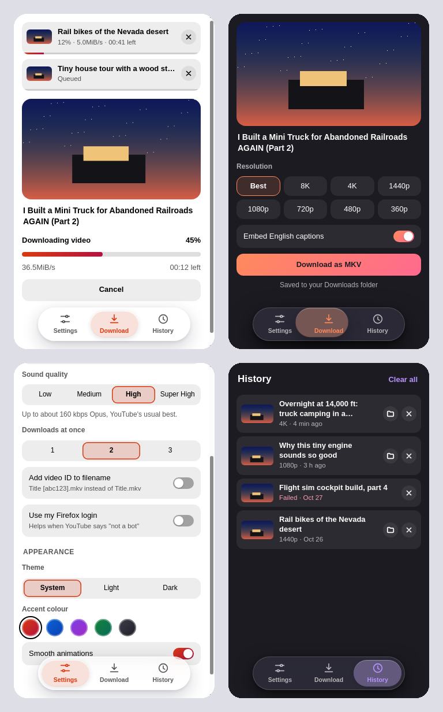

# yt-dlp Firefox Launcher



A sleek, modern Firefox extension paired with a Native Messaging PowerShell host that lets you seamlessly download YouTube videos directly from your browser using `yt-dlp` and `FFmpeg`. Featuring a floating dynamic glass UI design, multi-resolution selection, subtitle embedding, and concurrent download queueing.

## ✨ Features

* **Glass UI Design:** Frosted, floating navigation bar with smooth animations, sliding tab toggles, and tactile feedback.

* **Flexible Resolution & Audio Tiers:** Choose your desired video resolution (from Best / 8K down to 360p) and audio quality tiers (Low, Medium, High, Super High).

* **Concurrent Downloads & Queueing:** Manage multiple downloads at once with mini status cards stacked neatly at the top of the interface.

* **Subtitle & Metadata Support:** Automatically embed metadata, chapters, thumbnails, and English closed captions.

* **History & Quick File Reveal:** Keep track of downloaded videos with an integrated history tab and a "Show in Folder" shortcut.

* **Portable & Dynamic Host:** Automatically detects system tool locations (`yt-dlp`, `FFmpeg`, and `Deno`) via WinGet paths without needing hardcoded personal user directories.

## 🛠️ Prerequisites

Before installing the extension, make sure you have the required backend tools installed on Windows via PowerShell (`winget`):

```powershell
winget install yt-dlp.yt-dlp
winget install yt-dlp.FFmpeg
```

## 🚀 Installation & Setup

1. **Clone or Download** this repository to your computer.

2. **Install the Native Messaging Host:**
   * Navigate to the `host/` folder.
   * Run the `install.ps1` script to register the manifest with Firefox.

3. **Load the Extension in Firefox:**
   * Open Firefox and navigate to `about:debugging#/runtime/this-firefox`.
   * Click **Load Temporary Add-on...** and select the `extension/manifest.json` file from your project folder.